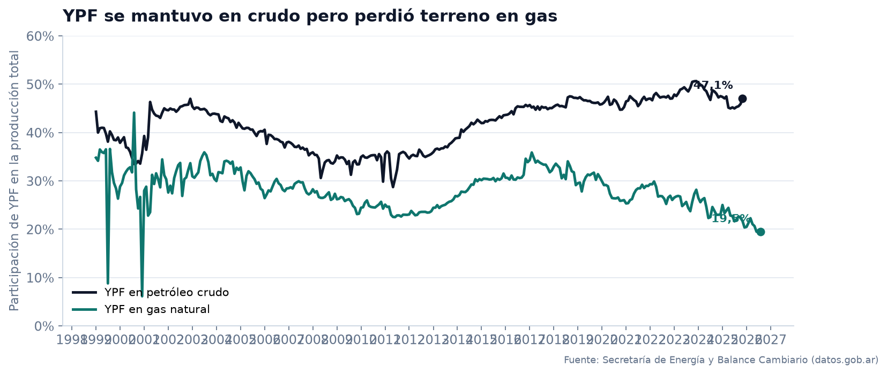

# El gas creció, YPF se quedó: hidrocarburos en Argentina

Análisis de la producción argentina de petróleo y gas con datos públicos de la
**Secretaría de Energía** y del **Balance Cambiario del Banco Central**, descargados
desde la API oficial de `datos.gob.ar`.

**Informe online:** https://sebacatena.github.io/hidrocarburos-ypf/



## Qué responde

- ¿Creció más el gas o el petróleo en las últimas tres décadas?
- ¿YPF ganó o perdió participación en cada hidrocarburo?
- ¿Qué otros productores ocuparon ese lugar?
- ¿Cuántos dólares entraron por el rubro petrolero?

## Hallazgos principales

Desde enero de 1996, con cada serie hasta su último mes disponible:

- El **gas natural creció 71,0%** (hasta septiembre de 2026).
- El **petróleo crudo creció 10,3%** (hasta noviembre de 2025).
  El gas creció casi **siete veces más** en el mismo período.
- **YPF se mantuvo en petróleo**: pasó del **44,3%** al **47,1%** de la
  producción nacional.
- **YPF perdió terreno en gas**: cayó del **34,8%** al **19,5%**, una pérdida de
  **15,3 puntos porcentuales**.
- **Pluspetrol** fue quien más ganó en gas: del **1,6%** al **11,0%** (+9,4 puntos).
  Total Austral pasó del 10,6% al 8,8%.
- Los **cobros por petróleo** del balance cambiario pasaron de US$ 164 M a
  US$ 1.318 M mensuales (**+705%** nominales, en dólares).

> Los números se recalculan cada vez que se ejecuta el análisis. Los del informe
> HTML son siempre los últimos de la serie.

## La trampa del proyecto: las unidades

Este análisis es un buen ejemplo de por qué hay que mirar los metadatos antes de
comparar dos series:

| Serie | Unidad original | Conversión |
|---|---|---|
| Crudo total | miles de m³ | — |
| YPF crudo | m³ | ÷ 1.000 → miles de m³ |
| Gas total | millones de m³ | — |
| YPF y otras empresas, gas | miles de m³ | ÷ 1.000 → millones de m³ |

Sin esa conversión, YPF aparecía produciendo más del 100% del petróleo nacional.

Tampoco se deflacta con el IPC: los ingresos están en **dólares**, así que el
índice de precios argentino sería el deflactor equivocado (el caso inverso del
proyecto `recaudacion-tributaria`).

## Estructura

```
descargar_datos.py           baja 8 series en 4 grupos desde la API
                             (solo biblioteca estándar)
analisis.py                  convierte unidades, calcula, grafica y genera el HTML
datos/
  produccion_total.csv       fecha, crudo_total, gas_total
  ypf_produccion.csv         fecha, ypf_crudo, ypf_gas
  otros_productores.csv      fecha, total_austral_gas, pluspetrol_gas
  ingresos.csv               fecha, cobros_petroleo, exportaciones_hidrocarburos
  hidrocarburos_procesados.csv  serie de gas con participaciones calculadas
  resumen.json               métricas principales
  fuente.json                URL, organismo, unidades y fechas de cada serie
graficos/                    los 5 gráficos en PNG
index.html                   informe publicado (GitHub Pages)
actualizar.bat               actualización con doble clic en Windows
requirements.txt             dependencias (pandas, matplotlib)
```

## Cómo reproducirlo

Requisitos: Python 3.10 o superior.

```bash
python -m pip install -r requirements.txt
python descargar_datos.py
python analisis.py
```

Después abrí `index.html` en el navegador.

En Windows, si `python` no funciona, probá `py`:

```powershell
py descargar_datos.py
py analisis.py
```

### Actualizar con un doble clic (Windows)

Con la primera instalación ya hecha (`python -m pip install -r requirements.txt`),
alcanza con hacer doble clic en **`actualizar.bat`**. Ese archivo:

1. baja los datos nuevos de la API oficial,
2. vuelve a calcular todo,
3. regenera los 5 gráficos y el `index.html`,
4. abre el informe en el navegador.

Si algo falla, la ventana queda abierta con el mensaje de error.

## Fuentes y método

- **Secretaría de Energía, Ministerio de Economía:**
  - `363.3_PRODUCCIONUDO__28` — Producción de petróleo crudo (miles de m³, mensual).
  - `364.3_PRODUCCIoNRAL__25` — Producción de gas natural (millones de m³, mensual).
  - `365.3_PRODUCCION_SA__35` — Producción de petróleo crudo YPF S.A. (m³, mensual).
  - `365.3_PRODUCCION_SA__32` — Producción de gas natural YPF S.A. (miles de m³, mensual).
  - `365.3_PRODUCCION.A.__42` — Gas natural Total Austral S.A. (miles de m³, mensual).
  - `365.3_PRODUCCION_SA__39` — Gas natural Pluspetrol S.A. (miles de m³, mensual).
- **Balance Cambiario, BCRA:**
  - `184.1_BIENES_COBLEO_0_M_22` — Bienes, cobros petróleo (millones de USD, mensual).
  - `75.3_GPOH_0_M_32` — Exportaciones de gas de petróleo y otros hidrocarburos
    (millones de USD FOB, mensual).
- **Participación:** producción de la empresa ÷ producción total nacional × 100.
  Se asume que la serie total incluye a todas las empresas.
- **"Resto de productores":** total nacional menos las tres empresas informadas.
  Es un residual, no una serie publicada.
- **Ingresos:** se grafica el dato mensual y una media móvil de 12 meses. Están en
  dólares corrientes, sin deflactar.

Las series no terminan en el mismo mes, así que cada indicador informa su propia
fecha. "Cobros por petróleo" y "exportaciones" no son exactamente lo mismo: el
primero registra entradas de divisas por el rubro y el segundo, ventas externas
declaradas. El análisis es descriptivo: no es un pronóstico ni una recomendación
de inversión.

## Cómo publicarlo en GitHub Pages

1. Crear un repositorio **público** llamado `hidrocarburos-ypf` en GitHub.
2. Subir esta carpeta.
3. En GitHub: **Settings → Pages**.
4. En *Source*, elegir **Deploy from a branch**.
5. Branch: **main** · Carpeta: **/ (root)**. Guardar.
6. Esperar 1 o 2 minutos. El informe queda en
   `https://TU-USUARIO.github.io/hidrocarburos-ypf/`.

Para actualizarlo: volver a correr los scripts, hacer commit y push. Pages se
actualiza solo.

## Autor

**Sebastián Catenacci** — [github.com/SebaCatena](https://github.com/SebaCatena)

Código bajo licencia MIT. Datos públicos de la Secretaría de Energía y del BCRA.
